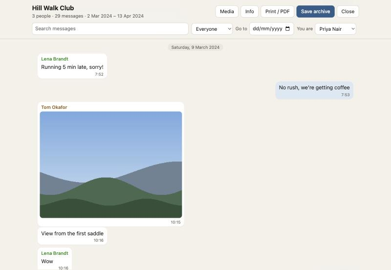

# Chat Keeper

**Turn a WhatsApp chat export into a clean, searchable archive, or a PDF with the photos inline. It all runs in your browser: nothing is uploaded.**

**Use it: [kushagra21.github.io/chat-keeper](https://kushagra21.github.io/chat-keeper/)**



WhatsApp's "Export chat" gives you a `.txt` file and a pile of loose photos, videos and voice notes. Chat Keeper turns that into something you can read, search, print and keep: a chat with someone who has died, a family group before you change phones, or a record of a dispute.

## Your chat stays on your device

- The site is a single static page on GitHub Pages. There is no server, account or analytics.
- The page reads your export with the browser's own file APIs. The file never leaves your computer or phone.
- The page's Content Security Policy sets `connect-src 'none'`, so the browser blocks every network request it might try to make. The exported archives have the same rule.
- **Check it yourself:** load the page, turn off Wi-Fi, then open your export. It still works. Or watch the Network tab in your browser's developer tools: nothing goes out.
- **Use it fully offline:** download [`chat-keeper.html`](https://kushagra21.github.io/chat-keeper/chat-keeper.html), one self-contained file, and open it from your disk.

## What it does

- **Reads any export**: the `.zip` WhatsApp makes, or the chat `.txt` together with its media, or a whole folder. Works with iPhone and Android exports, in any language and region, with 12- or 24-hour times. Day/month or month/day is worked out from the dates; you can switch it if a short chat leaves it unclear.
- **Shows the chat** with photos, videos, voice notes, stickers and documents in place. Pick who "you" are to put your messages on the right.
- **Search** every message, filter by person, jump to a date, and browse all photos and videos in a gallery.
- **Save an archive (.zip)**: an `index.html` that opens in any browser, offline; every file from the export, byte for byte; the original chat text; a `manifest.json`; and `SHA256SUMS.txt`.
- **Save a single page (.html)** with the photos inside it, for smaller chats.
- **Print or save as PDF**: the whole chat or a date range, as a dated transcript with photos and video stills inline and page numbers.
- **Checksums for records**: SHA-256 of the original export, the chat text and every file, in the archive and on the PDF's first page.

### Checking an archive later

```sh
cd "Chat name (WhatsApp archive)"
shasum -a 256 -c SHA256SUMS.txt
```

Every line should end in `OK`. The checksums show that the files haven't changed since the archive was made. They can't, on their own, prove where the original export came from. If a chat matters for a legal case, keep the original export and the phone too.

## Limits

- WhatsApp limits how much one export can hold (roughly 10,000 messages with media, or 40,000 without, depending on the phone). That happens before Chat Keeper sees the file.
- Very large exports (several GB) work best in a desktop browser. The PDF is made by the browser's print dialog, so print long chats in date ranges.
- `.opus` voice notes play in Chrome, Edge and Firefox. Some browsers, older Safari in particular, can't play them; every voice note has a download link as well.
- Times are shown as written in the export, in the phone's time zone at the time. The export doesn't record the zone.

## Develop

Needs Node 24.

```sh
npm install
npm run dev      # http://localhost:5173
npm test         # parser and export tests
npm run build    # dist/index.html, one self-contained file
```

- `src/parser.ts` reads the chat text. To add a format, add a line from a real export (with names changed) to `src/parser.test.ts`.
- `src/loader.ts` opens the zip or files and reads media only when it's needed.
- `src/viewer/` is the chat view, used both by the app and inside every exported archive (`src/archive-entry.ts`, built first as `build-archive/viewer.js`).
- `src/export.ts` writes archives; `src/viewer/print.ts` lays out the PDF.
- `scripts/make-sample.py` builds the made-up sample chat.

Pushing to `main` runs the tests and deploys to GitHub Pages. What has and hasn't been tested so far is in [docs/STATUS.md](docs/STATUS.md).

## Licence

MIT. Chat Keeper is not affiliated with WhatsApp or Meta.
